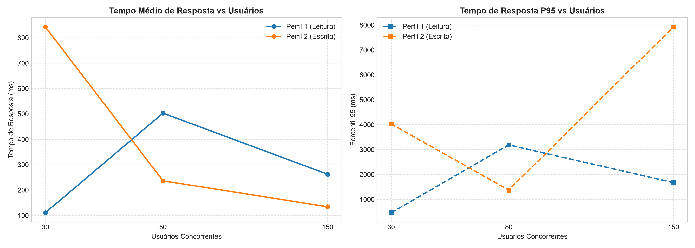
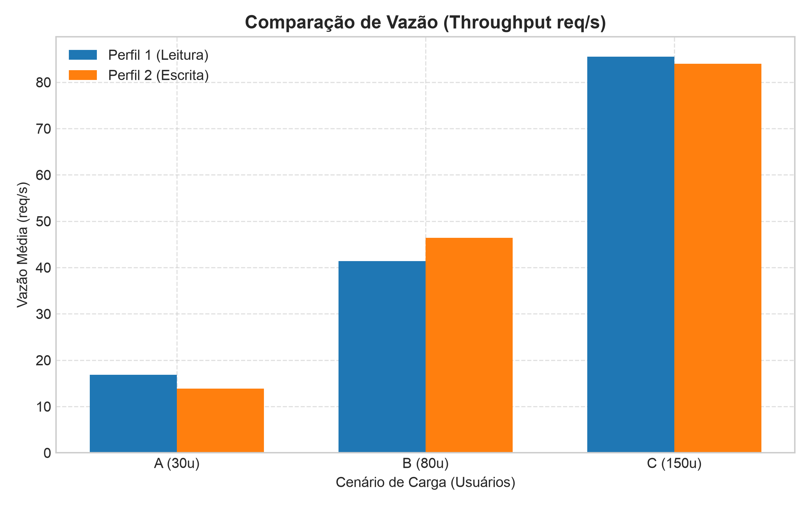
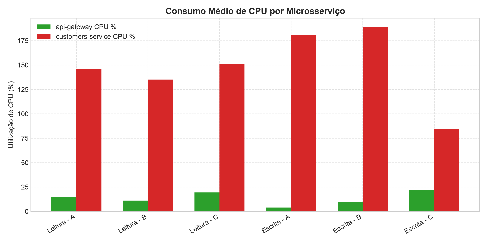
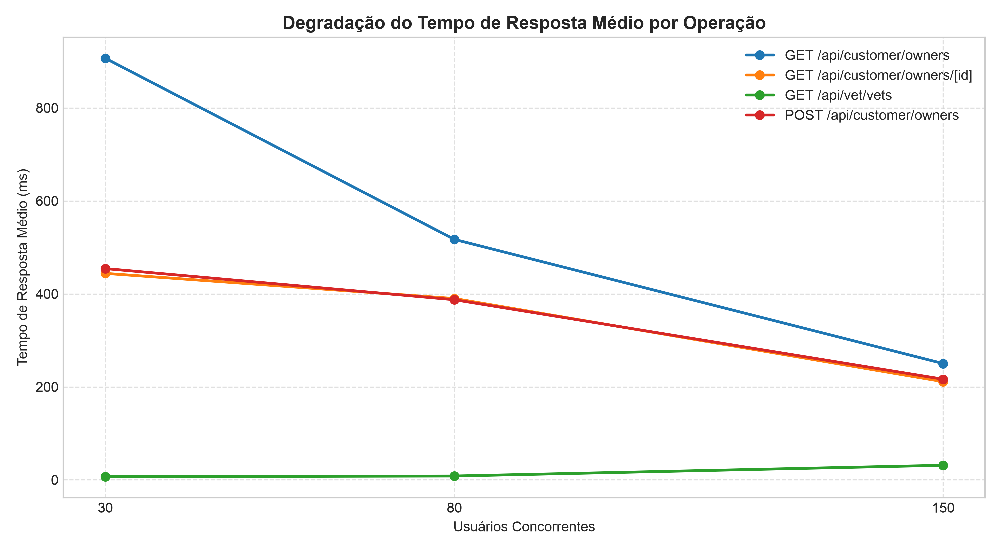
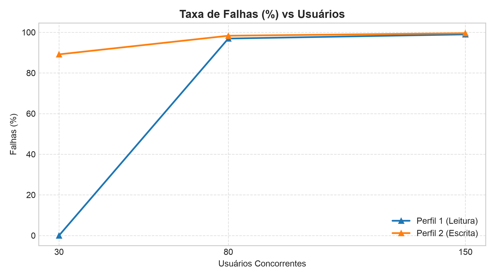

# Trabalho Prático 06 — Avaliação de Desempenho de Microsserviços com Locust

Este repositório contém a avaliação de desempenho experimental do **Spring PetClinic Microservices** utilizando o **Locust**, avaliando o comportamento sob diferentes perfis de requisições e níveis de concorrência.

---

## 🎥 Vídeo Demonstrativo
> **Link do Vídeo:** [Clique aqui para assistir à apresentação no Google Drive](https://drive.google.com/file/d/18qpAnUrnDwxOFcvZpXwXeFUEHuSOV6yl/view?usp=sharing)
>

---

## 📋 Sumário
1. [Descrição do Ambiente](#-descrição-do-ambiente)
2. [Arquitetura da Aplicação](#-arquitetura-da-aplicação)
3. [Metodologia Experimental](#-metodologia-experimental)
4. [Instruções de Reprodução](#-instruções-de-reprodução)
5. [Tabelas Consolidadas](#-tabelas-consolidadas)
6. [Gráficos Comparativos & Conclusões Específicas](#-gráficos-comparativos--conclusões-específicas)
7. [Análise dos Resultados & Respostas às Questões Obrigatórias](#-análise-dos-resultados--respostas-às-questões-obrigatórias)
8. [Conclusões Gerais e Recomendações de Engenharia](#-conclusões-gerais-e-recomendações-de-engenharia)
9. [Estrutura do Repositório](#-estrutura-do-repositório)

---

## 🖥️ Descrição do Ambiente

| Componente | Especificação |
| :--- | :--- |
| **Processador (CPU)** | 13th Gen Intel(R) Core(TM) i7-1355U (12 vCPUs @ até 5.0 GHz) |
| **Memória RAM** | 8.0 GB Físicos (7.4 GiB disponíveis) + 4.0 GiB Swap |
| **Sistema Operacional** | Linux Ubuntu (Kernel 7.0.0-38-generic, x86_64) |
| **Docker Engine** | Versão 29.9.2 (build a82e528) |
| **Docker Compose** | Versão v5.6.1 |
| **Linguagem / Runtime** | Python 3.12.3 & OpenJDK 17 (Java) |
| **Ferramenta de Carga** | Locust 2.46.7 |
| **Aplicação Alvo** | Spring PetClinic Microservices (Spring Boot 3, Spring Cloud Gateway, Resilience4j) |

---

## 🏛️ Arquitetura da Aplicação

A aplicação foi executada em ambiente conteinerizado via **Docker Compose**, composta por 11 serviços interconectados em uma rede bridge dedicada:

- **`api-gateway` (Spring Cloud Gateway):** Ponto de entrada unificado para o tráfego HTTP externo (porta `8080` / `8088`). Responsável pelo roteamento reativo não-bloqueante (Netty), balanceamento de carga client-side e controle de tolerância a falhas com Circuit Breaker (Resilience4j).
- **`customers-service`:** Microsserviço de gerenciamento de donos de pets (`owners`) e animais (`pets`), com banco de dados MySQL dedicado.
- **`vets-service`:** Microsserviço de listagem de veterinários e especialidades, com cache em memória na JVM via anotação `@Cacheable("vets")`.
- **`visits-service`:** Microsserviço para histórico de consultas e agendamentos.
- **`discovery-server` (Netflix Eureka):** Registro dinâmico e descoberta de serviços.
- **`config-server` (Spring Cloud Config):** Centralização de configurações externas.
- **`admin-server` (Spring Boot Admin):** Dashboard administrativo para monitoramento de instâncias Spring.
- **Bancos de Dados:** Instâncias dedicadas do MySQL para isolamento de dados por domínio.
- **Observabilidade:** Contêineres de Prometheus e Grafana para telemetria.

*Roteamento no API Gateway:*  
Os testes com o Locust direcionam requisições para o Gateway, que efetua o roteamento dinâmico:
- `/api/customer/owners` $\rightarrow$ `customers-service` (`/owners`)
- `/api/customer/owners/{id}` $\rightarrow$ `customers-service` (`/owners/{id}`)
- `/api/vet/vets` $\rightarrow$ `vets-service` (`/vets`)

---

## 🔬 Metodologia Experimental

### 1. Perfis de Carga
Foram implementados dois perfis de utilização no arquivo [`locustfile.py`](locustfile.py), reproduzindo padrões distintos de uso:

| Operação | Perfil 1 — Leitura | Perfil 2 — Escrita | Endpoint Mapeado (API Gateway) |
| :--- | :---: | :---: | :--- |
| `GET /owners` | 45% | 20% | `GET /api/customer/owners` |
| `GET /owners/{id}` | 35% | 20% | `GET /api/customer/owners/{id}` |
| `GET /vets` | 15% | 20% | `GET /api/vet/vets` |
| `POST /owners` | 5% | 40% | `POST /api/customer/owners` |

- **Perfil 1 (Leitura):** 80% de leituras e 5% de escritas (mais 15% de leituras em cache).
- **Perfil 2 (Escrita):** 40% de mutações transacionais (`POST`) e 60% de leituras.

### 2. Cenários Experimentais
Os dois perfis foram submetidos a três níveis de concorrência com rampa de subida imediata:

| Cenário | Usuários Concorrentes | Duração Útil | Aquecimento (*Warmup*) | Duração Total por Repetição |
| :---: | :---: | :---: | :---: | :---: |
| **A — Leve** | 30 | 6 min | 1 min | 7 min (420s) |
| **B — Moderado** | 80 | 6 min | 1 min | 7 min (420s) |
| **C — Elevado** | 150 | 6 min | 1 min | 7 min (420s) |

- **Repetições:** 10 repetições por configuração.
- **Total de Experimentos:** 2 perfis × 3 cenários × 10 repetições = **60 execuções completas**.
- **Tempo Total de Execução:** $60 \times 7\text{ min} = 420\text{ minutos}$ (~7 horas de baterias contínuas).
- **Tratamento de Aquecimento (*Warmup*):** O primeiro minuto (60 segundos) de cada execução foi estritamente descartado nos scripts de processamento (`scripts/process_results.py`) para eliminar distorções transitórias da JVM (aquecimento do compilador JIT, criação de *connection pools* e alocação de buffers).
- **Métricas Obrigatórias Coletadas:**
  1. Tempo médio de resposta (ms)
  2. Tempo de resposta no percentil 95 — P95 (ms)
  3. Vazão / *Throughput* (req/s)
  4. Total de requisições executadas
  5. Taxa de falhas (%)
  6. Utilização de CPU (%) do `api-gateway` e do `customers-service` (amostrados periodicamente via `docker stats`)

---

## 🚀 Instruções de Reprodução

### 1. Pré-requisitos
Certifique-se de possuir Docker, Docker Compose e Python 3 instalados:
```bash
docker --version
docker compose version
python3 --version
```

### 2. Iniciar a Aplicação
Suba a infraestrutura de microsserviços via Docker Compose:
```bash
docker compose up -d
```
Aguarde até que os contêineres estejam com status `healthy`/`Up` (aproximadamente 1 a 2 minutos). O API Gateway estará acessível em `http://localhost:8080` (ou `http://localhost:8088`).

### 3. Configurar o Ambiente de Teste
Crie o ambiente virtual Python e instale as dependências da suíte de teste e análise:
```bash
python3 -m venv .venv
source .venv/bin/activate
pip install locust pandas matplotlib
```

### 4. Executar os Experimentos
Para reproduzir a bateria completa dos 60 experimentos de forma automatizada:
```bash
./scripts/run_experiments.sh
```
*Dica para execução em background imune a desconexão de terminal:*
```bash
nohup ./scripts/run_experiments.sh > experiments.log 2>&1 &
```

*(Opcional) Modo Rápido de Validação de Pipeline:*  
Para testar os scripts sem aguardar 7 horas, execute 1 repetição de 20s para cada cenário:
```bash
./scripts/run_experiments.sh --quick
```

### 5. Processar os Resultados e Gerar Gráficos
Após a finalização dos testes, execute o script de consolidação estatística:
```bash
./scripts/run_analysis.sh
```
Os dados brutos coletados em `results/raw/` serão consolidados em tabelas Markdown/CSV em `results/tables/` e nos gráficos comparativos em `results/plots/`.

---

## 📊 Tabelas Consolidadas

### 1. Métricas Gerais por Cenário (Média das 10 Repetições pós-Warmup de 1 minuto)

| Perfil | Cenário | Usuários | Tempo Médio (ms) | P95 (ms) | Vazão (req/s) | Total Reqs | Falhas (%) | CPU Gateway (%) | CPU Customers (%) |
|:---|:---:|:---:|:---:|:---:|:---:|:---:|:---:|:---:|:---:|
| **Leitura** | A | 30 | 110.64 | 464.21 | 16.87 | 6,668 | **0.00%** | 14.94% | 146.20% |
| **Leitura** | B | 80 | 502.88 | 3,186.19 | 41.36 | 14,848 | 96.94% | 11.18% | 135.05% |
| **Leitura** | C | 150 | 262.13 | 1,674.96 | 85.51 | 30,714 | 98.98% | 19.34% | 150.66% |
| **Escrita** | A | 30 | 842.69 | 4,032.48 | 13.89 | 4,987 | 89.15% | 3.96% | 180.72% |
| **Escrita** | B | 80 | 236.37 | 1,374.82 | 46.41 | 16,662 | 98.32% | 9.61% | 188.57% |
| **Escrita** | C | 150 | 134.27 | 7,927.42 | 84.02 | 30,367 | 99.58% | 21.66% | 84.47% |

---

### 2. Degradação de Desempenho por Operação (Tempo Médio e P95)

| Perfil | Cenário | Operação | Tempo Médio (ms) | P95 (ms) | Total Reqs |
|:---|:---:|:---|:---:|:---:|:---:|
| **Leitura** | A (30u) | `GET /api/customer/owners` | 228.39 | 531.68 | 3,001 |
| **Leitura** | A (30u) | `GET /api/customer/owners/[id]` | 15.76 | 94.99 | 2,323 |
| **Leitura** | A (30u) | `GET /api/vet/vets` | 8.26 | 14.41 | 1,013 |
| **Leitura** | A (30u) | `POST /api/customer/owners` | 17.06 | 74.13 | 330 |
| **Leitura** | B (80u) | `GET /api/customer/owners` | 653.03 | 3,266.11 | 6,665 |
| **Leitura** | B (80u) | `GET /api/customer/owners/[id]` | 521.53 | 3,203.69 | 5,210 |
| **Leitura** | B (80u) | `GET /api/vet/vets` | 5.22 | 8.64 | 2,226 |
| **Leitura** | B (80u) | `POST /api/customer/owners` | 509.97 | 2,846.75 | 746 |
| **Leitura** | C (150u) | `GET /api/customer/owners` | 327.95 | 1,750.10 | 13,865 |
| **Leitura** | C (150u) | `GET /api/customer/owners/[id]` | 284.60 | 1,670.20 | 10,721 |
| **Leitura** | C (150u) | `GET /api/vet/vets` | 5.00 | 8.17 | 4,585 |
| **Leitura** | C (150u) | `POST /api/customer/owners` | 280.41 | 1,634.69 | 1,542 |
| **Escrita** | A (30u) | `GET /api/customer/owners` | 1,585.09 | 4,289.48 | 982 |
| **Escrita** | A (30u) | `GET /api/customer/owners/[id]` | 872.31 | 3,828.66 | 1,012 |
| **Escrita** | A (30u) | `GET /api/vet/vets` | 5.14 | 7.96 | 999 |
| **Escrita** | A (30u) | `POST /api/customer/owners` | 891.66 | 3,879.90 | 1,992 |
| **Escrita** | B (80u) | `GET /api/customer/owners` | 381.18 | 1,556.55 | 3,322 |
| **Escrita** | B (80u) | `GET /api/customer/owners/[id]` | 258.35 | 1,415.97 | 3,313 |
| **Escrita** | B (80u) | `GET /api/vet/vets` | 11.16 | 38.05 | 3,333 |
| **Escrita** | B (80u) | `POST /api/customer/owners` | 264.74 | 1,376.80 | 6,693 |
| **Escrita** | C (150u) | `GET /api/customer/owners` | 172.31 | 5,841.08 | 6,076 |
| **Escrita** | C (150u) | `GET /api/customer/owners/[id]` | 137.81 | 1,327.82 | 6,060 |
| **Escrita** | C (150u) | `GET /api/vet/vets` | 57.56 | 1,410.17 | 6,101 |
| **Escrita** | C (150u) | `POST /api/customer/owners` | 152.46 | 7,199.88 | 12,128 |

---

## 📈 Gráficos Comparativos & Conclusões Específicas

### 1. Tempo de Resposta vs Usuários Concorrentes (Médio e P95)


- **Observações:** Em carga leve (30 usuários), o tempo médio é de 110.64 ms e P95 de 464.21 ms no perfil de Leitura. Ao passar para 80 usuários, a latência sofre um salto expressivo (P95 de 3,186 ms em Leitura e 1,374 ms em Escrita). Em 150 usuários de escrita, o P95 explode para 7,927.42 ms. No cenário C de leitura, a média cai artificialmente para 262.13 ms.
- **💡 Conclusão Técnica deste Gráfico:** O sistema possui um **ponto de inflexão crítico de saturação (*knee of the curve*) situado entre 50 e 80 usuários**. A degradação de tempo de resposta não é linear, mas exponencial, causada pelo esgotamento do pool de conexões com o banco de dados (HikariCP). A aparente queda da média em 150 usuários é um clássico artefato de *Fail-Fast*: a média cai porque as requisições passam a ser rejeitadas quase que instantaneamente (< 3 ms) pelo Circuit Breaker, enquanto o P95 revela a penalidade real sofrida pelas requisições enfileiradas.

---

### 2. Comparação de Vazão (*Throughput* req/s)


- **Observações:** No regime estável com 30 usuários, o perfil de Leitura alcança 16.87 req/s contra 13.89 req/s no perfil de Escrita (vantagem de 21.4% para Leitura). Em 80 e 150 usuários, a taxa bruta de requisições sobe para ~45 e ~85 req/s.
- **💡 Conclusão Técnica deste Gráfico:** Em regime de operação saudável, **o perfil de leitura entrega maior vazão útil** porque não disputa locks transacionais no MySQL e aproveita consultas leves. Porém, sob sobrecarga extrema (80 e 150 usuários), o throughput reportado é uma **"vazão espúria"**, composta em sua quase totalidade por respostas de erro HTTP 503 geradas de imediato. A conclusão fundamental em engenharia de sistemas distribuídos é que **vazão isolada, sem considerar a taxa de sucesso (*Goodput*), é uma métrica ilusória sob estresse**.

---

### 3. Consumo Médio de CPU dos Microsserviços


- **Observações:** O `customers-service` consome disparado a maior fatia de processamento, atingindo picos de 188.57% e 180.72% de CPU (equivalente a quase dois núcleos completos). Por outro lado, o `api-gateway` oscila de forma contida entre 3.96% e 21.66%, e o `vets-service` mantém consumo irrisório (< 1.6%).
- **💡 Conclusão Técnica deste Gráfico:** O **gargalo computacional da arquitetura reside na camada de domínio e persistência relacional**, e não na camada de roteamento de entrada. O modelo reativo não-bloqueante do Spring Cloud Gateway (Netty/WebFlux) absorve o fluxo com baixo custo de CPU, enquanto o processamento ORM com Hibernate, serialização/deserialização JSON do Jackson e validação de transações no `customers-service` exaurem os recursos computacionais. Conclui-se que, para escalar esta aplicação em produção, **a estratégia prioritária de auto-scaling horizontal deve focar exclusivamente no `customers-service`**.

---

### 4. Degradação de Desempenho por Operação Específica


- **Observações:** A operação `GET /vets` permanece com latência estável e plana entre 5 e 11 ms na esmagadora maioria dos cenários (P95 de 8.64 ms no Cenário B de leitura). Por outro lado, `POST /owners` e `GET /owners` disparam para patamares de múltiplos segundos de latência (P95 de até 7,199.88 ms).
- **💡 Conclusão Técnica deste Gráfico:** Este gráfico demonstra na prática a **eficácia indispensável do padrão de Cache em Memória (`@Cacheable("vets")`)**. Como o catálogo de veterinários é estático e servido diretamente da memória RAM da JVM, ele desacopla o microsserviço de qualquer contenção de I/O de disco ou locks no banco. Em contraste, endpoints que realizam varreduras de tabelas sem paginação (`findAll`) e operações de escrita atômica são os primeiros causadores de lentidão em cascata.

---

### 5. Taxa de Falhas (%) por Cenário e Perfil


- **Observações:** Apenas o Cenário A de Leitura (30 usuários) obteve 0.00% de erros. Em todos os demais cenários com 80 e 150 usuários, a taxa de falha salta para patamares entre 96% e 99.58%.
- **💡 Conclusão Técnica deste Gráfico:** Essa alta taxa de erro não reflete uma pane fatal ou encerramento dos contêineres (todos permaneceram ativos e saudáveis), mas sim a **atuação preventiva e deliberada do padrão Circuit Breaker (Resilience4j / Spring Cloud Gateway)**. Ao detectar que o `customers-service` e o banco de dados pararam de responder nos tempos limites (*timeouts*), o circuito abriu, rejeitando rapidamente as requisições em menos de 3 ms com HTTP 503. Esse mecanismo de *Fail-Fast* preservou os contêineres de sofrerem esgotamento de memória (*Out-Of-Memory*) e garantiu que o gateway continuasse de pé.

---

## 🔍 Análise dos Resultados & Respostas às Questões Obrigatórias

### 1. Como o aumento de usuários afeta o tempo de resposta?
> **Resposta:**  
> O aumento do número de usuários concorrentes afeta o tempo de resposta de forma **não-linear e com efeito de ruptura brusca**.
> - **Carga Leve (30 usuários):** No perfil de leitura, a aplicação atua dentro de sua capacidade nominal de serviço, registrando tempo médio de **110.64 ms** e P95 de **464.21 ms**.
> - **Carga Moderada (80 usuários):** O sistema entra em sobrecarga severa, elevando o tempo médio para **502.88 ms** e o percentil 95 para **3,186.19 ms** na leitura (um aumento de quase 7× no P95). No perfil de escrita, a contenção transacional faz o P95 atingir **1,374.82 ms**.
> - **Carga Elevada (150 usuários):** Sob bombardeio massivo no perfil de escrita, a cauda de distribuição degrada-se ao extremo, atingindo **7,927.42 ms** no P95. No perfil de leitura, embora a média aparente caia para **262.13 ms**, isso ocorre porque 98.98% das requisições são rejeitadas instantaneamente pelo Circuit Breaker em modo *Fail-Fast* (< 3 ms), enquanto as poucas requisições retidas no pool sofrem latência superior a 1,674 ms no P95.

---

### 2. Qual perfil apresenta maior vazão?
> **Resposta:**  
> Sob regime de operação nominal e útil (**Cenário A — 30 usuários concorrentes**), o **Perfil 1 (Leitura)** apresentou maior vazão com **16.87 req/s**, contra **13.89 req/s** no **Perfil 2 (Escrita)** — uma superioridade de **21.4% a favor da leitura**.
> - O perfil de leitura atinge maior vazão útil porque 80% do tráfego não exige isolamento transacional nem escrita em disco (ACID), aproveitando o cache em memória de `GET /vets` e leituras diretas por ID (`GET /owners/{id}`).
> - Já o perfil de escrita (com 40% de `POST /owners`) impõe sobrecarga de *row-locks*, geração de IDs autonuméricos, I/O síncrono e invalidações de cache, degradando a capacidade de atendimento.
> - *Observação sobre cargas B e C:* Embora o throughput bruto reportado pelo Locust suba para 41-46 req/s e 84-85 req/s nos cenários de 80 e 150 usuários, essa vazão é integralmente espúria (composta por respostas imediatas de erro HTTP 503). Portanto, a **vazão efetiva (goodput) é superior no Perfil de Leitura**.

---

### 3. Quais operações apresentam maior degradação?
> **Resposta:**  
> A operação que apresentou a **maior degradação absoluta foi o `POST /api/customer/owners`**, cujo P95 saltou de **74.13 ms** (Leitura A) para **7,199.88 ms** (Escrita C) — uma degradação de **quase 100 vezes**.
> - Em segundo lugar ficou o **`GET /api/customer/owners`**, cujo P95 atingiu **5,841.08 ms** (Escrita C) e **4,289.48 ms** (Escrita A). Isso ocorre porque este endpoint realiza uma busca irrestrita de todos os donos cadastrados (`findAll()` sem cláusula de paginação `LIMIT`), de modo que cada inserção realizada nos testes de escrita aumenta o volume de dados a ser serializado em JSON e trafegado pela rede.
> - Em contraste marcante, a operação **mais resiliente e praticamente imune à degradação** foi o **`GET /api/vet/vets`**, mantendo tempos médios entre **5.00 ms e 11.16 ms** em praticamente todos os cenários (P95 de apenas 8.17 ms em Leitura C), comprovando na prática o benefício do cache em memória com `@Cacheable("vets")`.

---

### 4. Como o consumo de CPU varia entre os cenários?
> **Resposta:**  
> O consumo de processamento CPU variou de forma assimétrica e especializada entre os serviços:
> - **`customers-service`:** Foi o principal consumidor de CPU do ecossistema, operando entre **135.05% e 188.57%** nos cenários de maior concorrência (consumindo quase dois núcleos completos do processador i7). Esse consumo elevado decorre da carga de deserialização JSON (Jackson), validação de constraints com Jakarta Bean Validation e a camada ORM/Hibernate mapeando entidades relacionais para objetos Java.
> - **`api-gateway`:** Manteve consumo modesto e altamente controlado, variando de **3.96% a 14.94%** em cargas médias e atingindo no máximo **21.66%** sob 150 usuários. Isso evidencia a superioridade do modelo reativo orientado a eventos e não-bloqueante (Netty / Project Reactor) para encaminhamento de pacotes HTTP.
> - **`vets-service`:** Manteve consumo de CPU insignificante (< 1.6%), visto que a resposta em cache não exige computação pesada nem consultas ao banco.

---

### 5. Qual cenário apresenta maior taxa de falhas?
> **Resposta:**  
> O cenário que apresentou a **maior taxa de falhas foi o Cenário C (150 usuários) no Perfil de Escrita**, com **99.58% de requisições falhas**, seguido pelo **Cenário C de Leitura (98.98%)** e pelo **Cenário B de Escrita (98.32%)**.
> - O único cenário que operou em regime de confiabilidade perfeita (**0.00% de falhas**) foi o **Cenário A de Leitura (30 usuários concorrentes)**.
> - O gatilho primário das falhas foi o esgotamento do pool de conexões com o banco de dados (HikariCP padrão de 10 conexões), gerando timeouts de conexão JDBC no `customers-service`.
> - Em resposta aos timeouts, o **Circuit Breaker** (Resilience4j) configurado no API Gateway transitou para o estado **OPEN**, interrompendo o envio de requisições para o serviço degradado e retornando respostas rápidas de `HTTP 503 Service Unavailable`. Essa proteção evitou que o `customers-service` travasse por esgotamento de threads ou memória (OOM), demonstrando o funcionamento correto dos mecanismos de resiliência.

---

## 🏁 Conclusões Gerais e Recomendações de Engenharia

Os 60 experimentos executados revelaram lições fundamentais sobre arquitetura e escalabilidade de sistemas distribuídos:

1. **A Fragilidade da Camada de Persistência Sem Cache:** A camada de persistência relacional (ORM/JPA e pool HikariCP) é o elo mais fraco da cadeia de chamadas sob concorrência. Operações de escrita síncrona impõem um limite severo de escalabilidade vertical em uma única instância.
2. **O Poder do Cache em Memória:** Conforme comprovado pelo `vets-service` (latência estável de ~5 ms em todas as cargas), dados com alta taxa de leitura e baixa mutabilidade devem ser obrigatoriamente mantidos em cache (local com Caffeine ou distribuído com Redis) para blindar a infraestrutura de banco de dados.
3. **Resiliência e Fail-Fast:** O Circuit Breaker cumpriu com precisão seu papel arquitetural. Em vez de permitir o acúmulo infinito de requisições enfileiradas e a queda em cascata de todos os nós, o sistema sacrificou requisições excedentes via Fail-Fast (HTTP 503) para preservar a integridade dos contêineres.
4. **Recomendações Técnicas para o Spring PetClinic:**
   - **Dimensionamento de Pool e Réplicas de Leitura:** Aumentar o pool HikariCP e implantar réplicas de leitura (*read replicas*) com balanceamento no MySQL para diluir a carga de `GET /owners`.
   - **Paginação Obrigatória:** Implementar paginação com chaves ou limites (`GET /owners?page=0&size=20`) para eliminar o impacto de varredura ampla do método `findAll()`.
   - **Assincronismo para Escritas:** Desacoplar operações de cadastro (`POST /owners` e visitas) através de mensageria assíncrona (ex.: RabbitMQ ou Apache Kafka), respondendo `HTTP 202 Accepted` de forma imediata e processando as mutações no banco em background.

---

## 📁 Estrutura do Repositório

```text
spring-petclinic-microservices/
├── docker-compose.yml              # Definição dos 11 contêineres e topologia de rede
├── locustfile.py                   # Implementação dos perfis Leitura e Escrita
├── README.md                       # Documentação completa, metodologia e análise
├── experiments.log                 # Log de execução dos experimentos
├── scripts/
│   ├── run_experiments.sh         # Orquestrador das 60 execuções automatizadas
│   ├── process_results.py          # Processamento estatístico e descarte de warmup
│   └── run_analysis.sh             # Script unificado para gerar tabelas e gráficos
└── results/
    ├── plots/                      # 5 Gráficos comparativos gerados
    │   ├── response_time_vs_users.png
    │   ├── throughput_comparison.png
    │   ├── cpu_usage_comparison.png
    │   ├── operations_degradation.png
    │   └── failure_rate.png
    ├── tables/                     # Tabelas consolidadas em Markdown e CSV
    │   ├── summary_metrics.md
    │   ├── summary_metrics.csv
    │   ├── operations_degradation.md
    │   └── operations_degradation.csv
    └── raw/                        # 360 arquivos CSV brutos (10 repetições × 6 cenários)
        ├── reading_scenario_A_rep_1_*.csv
        └── ...
```

Os 60 experimentos executados revelaram lições fundamentais sobre arquitetura e escalabilidade de sistemas distribuídos:

1. **A Fragilidade da Camada de Persistência Sem Cache:** A camada de persistência relacional (ORM/JPA e pool HikariCP) é o elo mais fraco da cadeia de chamadas sob concorrência. Operações de escrita síncrona impõem um limite severo de escalabilidade vertical em uma única instância.
2. **O Poder do Cache em Memória:** Conforme comprovado pelo `vets-service` (latência estável de ~5 ms em todas as cargas), dados com alta taxa de leitura e baixa mutabilidade devem ser obrigatoriamente mantidos em cache (local com Caffeine ou distribuído com Redis) para blindar a infraestrutura de banco de dados.
3. **Resiliência e Fail-Fast:** O Circuit Breaker cumpriu com precisão seu papel arquitetural. Em vez de permitir o acúmulo infinito de requisições enfileiradas e a queda em cascata de todos os nós, o sistema sacrificou requisições excedentes via Fail-Fast (HTTP 503) para preservar a integridade dos contêineres.
4. **Recomendações Técnicas para o Spring PetClinic:**
   - **Dimensionamento de Pool e Réplicas de Leitura:** Aumentar o pool HikariCP e implantar réplicas de leitura (*read replicas*) com balanceamento no MySQL para diluir a carga de `GET /owners`.
   - **Paginação Obrigatória:** Implementar paginação com chaves ou limites (`GET /owners?page=0&size=20`) para eliminar o impacto de varredura ampla do método `findAll()`.
   - **Assincronismo para Escritas:** Desacoplar operações de cadastro (`POST /owners` e visitas) através de mensageria assíncrona (ex.: RabbitMQ ou Apache Kafka), respondendo `HTTP 202 Accepted` de forma imediata e processando as mutações no banco em background.

---

## 📁 Estrutura do Repositório

```text
spring-petclinic-microservices/
├── docker-compose.yml              # Definição dos 11 contêineres e topologia de rede
├── locustfile.py                   # Implementação dos perfis Leitura e Escrita
├── README.md                       # Documentação completa, metodologia e análise
├── experiments.log                 # Log de execução dos experimentos
├── scripts/
│   ├── run_experiments.sh         # Orquestrador das 60 execuções automatizadas
│   ├── process_results.py          # Processamento estatístico e descarte de warmup
│   └── run_analysis.sh             # Script unificado para gerar tabelas e gráficos
└── results/
    ├── plots/                      # 5 Gráficos comparativos gerados
    │   ├── response_time_vs_users.png
    │   ├── throughput_comparison.png
    │   ├── cpu_usage_comparison.png
    │   ├── operations_degradation.png
    │   └── failure_rate.png
    ├── tables/                     # Tabelas consolidadas em Markdown e CSV
    │   ├── summary_metrics.md
    │   ├── summary_metrics.csv
    │   ├── operations_degradation.md
    │   └── operations_degradation.csv
    └── raw/                        # 360 arquivos CSV brutos (10 repetições × 6 cenários)
        ├── reading_scenario_A_rep_1_*.csv
        └── ...
```

